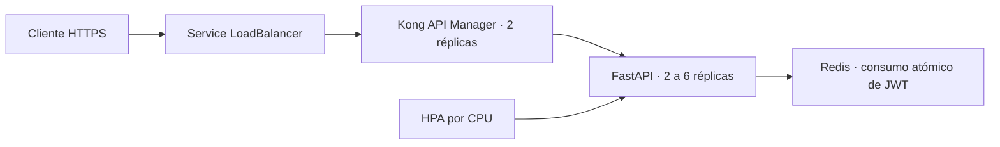

# Banco Pichincha · DevOps Technical Assessment

Microservicio REST con API Manager, JWT de un uso, balanceo, HTTPS, infraestructura
Kubernetes y pipeline CI/CD. El contrato conserva `/DevOps`, `X-JWT-KWY` y el texto
`will be send` exactamente como aparecen en el enunciado.

## Arquitectura



Kong exige simultáneamente API key y JWT. Un adaptador previo convierte
internamente el JWT crudo del header del PDF al formato Bearer que necesita el
plugin de Kong. El cliente no cambia. FastAPI vuelve a validar credenciales y
reclama el `jti` mediante `SET NX EX` en Redis. Repetir un JWT devuelve 409 incluso
si la segunda petición llega a otra réplica. No existe un emisor público de tokens.

## Inicio rápido: Docker Compose

Requisitos: Docker Engine/Compose y Python 3.12. En Windows, Docker Desktop debe
estar ejecutándose con contenedores Linux. Ejecutar desde la raíz del repositorio.

```powershell
python -m venv .venv
.\.venv\Scripts\python.exe -m pip install -r requirements-dev.lock
.\.venv\Scripts\python.exe -m scripts.prepare_local
docker compose up -d --build --wait
.\.venv\Scripts\python.exe -m scripts.smoke --require-two-backends
```

Linux/macOS: sustituir `.\.venv\Scripts\python.exe` por `.venv/bin/python`.
La URL local es **https://localhost:8443/DevOps**. Solo se publica el puerto de Kong
sobre loopback; los backends, Redis y la API administrativa no se publican.

La preparación crea `.env` y `.runtime/` ignorados por Git: secreto de firma aleatorio,
configuración de Kong y certificado local de 30 días. Repetirla conserva las claves.
El certificado local debe verificarse con `--cacert`; no usar `--insecure`.
Para regenerar el certificado local, retirar únicamente `.runtime/tls.crt` y
`.runtime/tls.key`, ejecutar la preparación y recrear Kong.

### Petición del evaluador (Bash)

```bash
JWT=$(.venv/bin/python -m scripts.issue_token --ttl 60)
curl --cacert .runtime/tls.crt -X POST \
  -H 'X-Parse-REST-API-Key: 2f5ae96c-b558-4c7b-a590-a501ae1c3f6c' \
  -H "X-JWT-KWY: ${JWT}" \
  -H 'Content-Type: application/json' \
  -d '{"message":"This is a test","to":"Juan Perez","from":"Rita Asturia","timeToLifeSec":45}' \
  https://localhost:8443/DevOps
```

PowerShell:

```powershell
$jwt = .\.venv\Scripts\python.exe -m scripts.issue_token --ttl 60
$headers = @{
  'X-Parse-REST-API-Key' = '2f5ae96c-b558-4c7b-a590-a501ae1c3f6c'
  'X-JWT-KWY' = $jwt
}
# curl.exe permite confiar explícitamente en el certificado local.
$body = '{"message":"This is a test","to":"Juan Perez","from":"Rita Asturia","timeToLifeSec":45}'
curl.exe --cacert .runtime/tls.crt -X POST -H "X-Parse-REST-API-Key: $($headers['X-Parse-REST-API-Key'])" -H "X-JWT-KWY: $jwt" -H 'Content-Type: application/json' -d $body https://localhost:8443/DevOps
```

Resultado:

```json
{"message":"Hello Juan Perez your message will be send"}
```

Generar un JWT nuevo para cada transacción. La CLI permite TTL de 1 a 300 segundos.
El candidato entrega un token recién generado al evaluador por un canal acordado;
no debe entregar el secreto de firma. En producción, configurar `JWT_SECRET` en el
entorno del operador para que coincida con el desplegado. Un token de la instalación
local no sirve en producción si las claves difieren.

## Contrato y errores

| Caso | Resultado |
|---|---|
| POST autenticado y datos válidos | 200, JSON del enunciado con `to` dinámico |
| GET, PUT, PATCH, DELETE, OPTIONS, TRACE | 405, cuerpo literal `ERROR` |
| HEAD | 405 sin cuerpo, conforme a HTTP |
| Falta API key/JWT, firma o claims inválidos | 401 |
| JWT ya utilizado | 409 |
| JSON/campos inválidos | 422 |
| Content-Type distinto de application/json | 415 |
| Cuerpo mayor a 16 KiB | 413 |
| Redis no disponible | 503; no se permite la transacción |
| Ruta desconocida o `/DevOps/` | 404 |

`message`, `to` y `from` son textos no vacíos (máximo 4096 caracteres); se recortan
espacios externos. `timeToLifeSec` es un entero de 1 a 86400, sin coerción de strings
ni booleanos. No se aceptan campos extra. Su semántica de negocio no está definida
en el PDF: se valida, pero no se envían ni almacenan mensajes. La caducidad de JWT
es independiente y está en sus claims. Las solicitudes inválidas no consumen JWT.

## Pruebas y calidad

```bash
python -m pytest --cov=devops_service --cov-report=term-missing --cov-report=xml
python -m ruff check src tests scripts
python -m ruff format --check src tests scripts
python -m bandit -r src -q
python -m pip_audit -r requirements.lock --no-deps --disable-pip
python -m build --no-isolation
python -m scripts.smoke --require-two-backends
```

El umbral de cobertura es 95% incluyendo ramas; el PDF no indica un porcentaje.
Los commits iniciales registran pruebas fallidas antes de implementar el endpoint.
Las pruebas de aplicación usan fakeredis para reproducir estado compartido y fallos;
la prueba de integración ejecuta Kong y Redis reales, verifica dos backends mediante
`X-Served-By` y envía ocho peticiones concurrentes con el mismo JWT.

`requirements.lock` fija todas las dependencias de ejecución y
`requirements-dev.lock` las de desarrollo. Para actualizarlas, resolver en un entorno
limpio, auditar y probar antes de versionar ambos archivos. Las imágenes base y
las acciones del pipeline están fijadas por digest/commit.

## Kubernetes y escalado

Consultar [la guía de despliegue](docs/deployment.md). Los manifiestos exigen
Kubernetes 1.30+ por `minDomains` y dos nodos worker elegibles. La versión validada
localmente se registra en [evidencias](docs/evidence.md).

- Dos réplicas iniciales de FastAPI y Kong distribuidas entre dos hosts.
- HPA de FastAPI: mínimo 2, máximo 6, objetivo CPU 60% de la solicitud de 100m.
- Probes de vida, preparación y arranque; despliegue progresivo; PDB.
- Redis con volumen persistente y AOF `appendfsync always`.
- NetworkPolicy restringe backend a Kong y Redis a los pods del servicio.
- El CNI de producción debe aplicar NetworkPolicy; kind por defecto no lo hace.

El escalado es de pods, no de máquinas. Dos workers de kind son dos nodos Kubernetes
pero comparten la máquina anfitriona; no constituyen alta disponibilidad física.
Redis es una dependencia única de esta entrega: su caída produce 503 y la pérdida
completa de sus datos elimina el historial de tokens consumidos aún vigentes.

## Pipeline

[`.github/workflows/ci-cd.yml`](.github/workflows/ci-cd.yml):

1. **build:** instalar dependencias fijadas, empaquetar Python y construir imagen.
2. **test:** lint, formato, Bandit, auditoría, pytest/cobertura e integración HTTPS.
3. **publish:** solo master; publicar en GHCR la imagen exacta que fue probada.
4. **deploy:** solo master; aplicar referencia inmutable, esperar rollout y probar
   el endpoint público HTTPS con verificación del certificado y dos backends.

Push a cualquier rama y pull requests ejecutan build/test. `workflow_dispatch`
permite ejecución manual; `image_digest` selecciona una versión publicada del mismo
repositorio para despliegue/rollback desde master. Sin ese input se construye y
publica la versión actual. Producción no se despliega desde otras ramas.

La ejecución real en GitHub requiere publicar el repositorio y configurar el
environment `production`. Los detalles están en la guía; tener el YAML local no
constituye evidencia de una ejecución remota exitosa.

## Entrega y documentación

- [Diseño y decisiones](docs/design.md)
- [Operación y despliegue](docs/deployment.md)
- [Matriz de requisitos](docs/requirements.md)
- [Evidencias verificadas](docs/evidence.md)
- [Fuentes oficiales consultadas](docs/references.md)

El endpoint local sirve para demostración. La URL pública definitiva y el enlace
al repositorio deben completarse tras configurar el destino del candidato.
